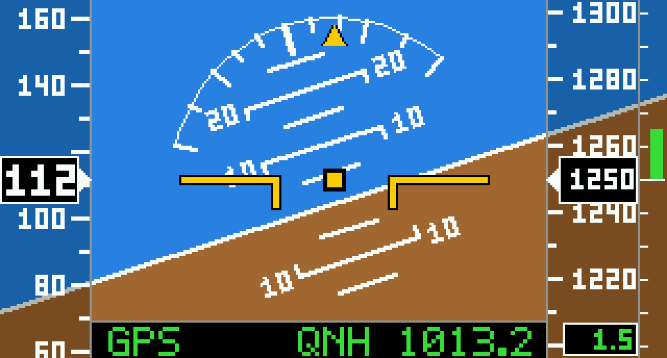
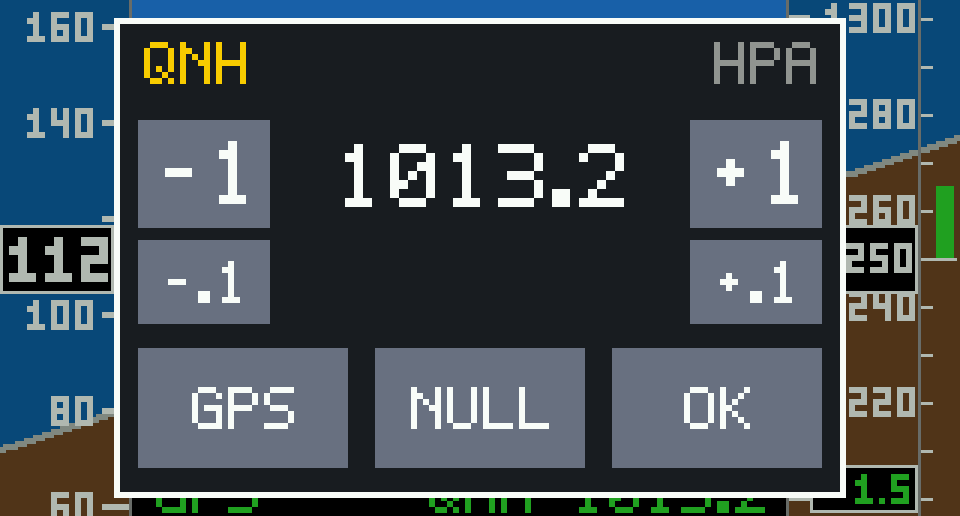

# Künstlicher Horizont (Attitude Indicator)

Künstlicher Horizont im Stil eines Garmin Glascockpits für das Waveshare ESP32-C6-Touch-LCD-1.47**
(172×320-Display, im Querformat 320×172). Geschrieben in C mit ESP-IDF, ohne LVGL.

## Vorschau

Hauptanzeige mit Speed-Band links, Höhenband und Variometer rechts und der Statuszeile unten:



QNH-Menü (Antippen des Displays):



Die Bilder sind keine Fotos. Sie sind mit demselben Zeichencode wie auf dem Gerät am PC gerendert, mit Beispielwerten (112 km/h, 1250 m, +1,5 m/s, QNH 1013,2).

## Funktionen

- Horizont mit Nick-Leiter (5°-Schritte, Zahlen bei 10°/20°/30°) und mitdrehender Roll-Skala
- **Speed-Band** links (GPS-Geschwindigkeit über Grund, km/h oder Knoten)
- **Höhenband** rechts (Barometer, Meter oder Fuß) mit **Variometer** (±5 m/s)
- **Statuszeile** unten: "GPS" bei gültigem Empfang, aktuelles QNH
- **Touch-Menü** zum Einstellen des QNH (Antippen des Displays)
- Fluglage aus dem Beschleunigungs- und Drehratensensor (QMI8658) per Komplementärfilter
- QNH und Trimmung bleiben nach dem Neustart erhalten (NVS)

## Hardware

| Bauteil | Anschluss |
|---|---|
| Board | Waveshare ESP32-C6-Touch-LCD-1.47 |
| Display (JD9853, SPI) | SCLK 1, MOSI 2, CS 14, DC 15, RST 22, BL 23 |
| Touch (AXS5106L), IMU (QMI8658) | I2C: SDA 18, SCL 19, Touch-RST 20, Touch-INT 21 |
| BOOT-Taste | GPIO9 |
| Barometer BMP280 / BME280 | I2C-Bus (SDA 18, SCL 19), Adresse 0x76 oder 0x77 |
| GPS (u-blox, UBX NAV-PVT, 115200 Baud) | TX des GPS an **GPIO7** (`GPS_RX_PIN`), 3,3 V, GND |

Das GPS wird nur gelesen. Das RX-Kabel des Moduls bleibt unbenutzt. Unterstützt werden das binäre u-blox-Protokoll UBX (Nachricht NAV-PVT) und NMEA (RMC/GGA); die Baudrate stellt man mit `GPS_BAUD` ein.

## Bauen und flashen

Benötigt wird ESP-IDF ab 5.3 (getestet mit 5.5).

```bash
. ~/esp/esp-idf/export.sh
idf.py set-target esp32c6
idf.py build
idf.py -p /dev/ttyACM0 flash monitor
```

Den Monitor beenden Sie mit **Strg + T**, dann **X**.

## Konfiguration

Alle Einstellungen stehen in `main/config.h`:

| Einstellung | Bedeutung |
|---|---|
| `LCD_MIRROR_X`, `LCD_MIRROR_Y`, `LCD_GAP_X`, `LCD_GAP_Y` | Ausrichtung und Verschiebung des Bildes |
| `LCD_INVERT`, `LCD_RGB_BGR` | Farbdarstellung des Panels. Mit `COLOR_TEST 1` zeigt das Display Farbbalken zum Einstellen. |
| `MAP_FWD`, `MAP_RIGHT`, `MAP_DOWN` | Zuordnung der IMU-Achsen zu den Flugzeugachsen |
| `GPS_RX_PIN`, `GPS_BAUD` | GPS-Anschluss |
| `SPEED_KT`, `ALT_FT` | Einheiten (km/h oder Knoten, Meter oder Fuß) |
| `VARIO_ALPHA`, `VARIO_BETA` | Filter des Variometers |
| `FORCE_DEMO`, `DEMO_SENSORS` | Simulierte Fluglage und simulierte Sensorwerte zum Testen |
| `TOUCH_DEBUG`, `TOUCH_FLIP_X`, `TOUCH_FLIP_Y` | Touch-Diagnose und Spiegelung |

Die Werte für Display und Achsen hängen von Panel und Einbaulage ab und müssen für Ihr Gerät einmal angepasst werden.

## Bedienung

| Aktion | Wirkung |
|---|---|
| Display antippen | Menü öffnen |
| Menü: **−1 / +1 / −.1 / +.1** | QNH einstellen (Taste halten wiederholt) |
| Menü: **GPS** | QNH so setzen, dass die Höhe der GPS-Höhe entspricht (Fix und Barometer nötig) |
| Menü: **NULL** | aktuelle Lage als Null setzen (Horizont waagerecht) |
| Menü: **OK** | Menü schließen (schließt auch nach 15 s ohne Eingabe) |
| BOOT kurz | Lage als Null setzen |
| BOOT lang (> 1,5 s) | Höhe kalibrieren (auf GPS-Höhe, ohne Fix auf 0 m) |

## Projektstruktur

```
├── CMakeLists.txt
├── sdkconfig.defaults
└── main/
    ├── CMakeLists.txt
    ├── config.h      Pins und Einstellungen
    ├── main.c        Zeichnen, Menü, Hauptschleife, Display, IMU
    ├── sensors.c/.h  BMP280/BME280, Variometer, GPS (UBX/NMEA)
    ├── touch.c/.h    Touch-Treiber AXS5106L
    └── settings.c/.h Speichern im NVS
```

## Hinweise und bekannte Einschränkungen

- Der JD9853 wird mit dem eingebauten ST7789-Treiber betrieben. Das funktioniert, die chip-eigene Initialisierung (Gamma, Spannungen) wird aber nicht gesetzt.
- Die angezeigte Geschwindigkeit ist die **Geschwindigkeit über Grund** (GPS), nicht die Fluggeschwindigkeit.
- Das Variometer wird nur aus dem Luftdruck berechnet und braucht ein bis zwei Sekunden zum Einschwingen.
- Die Höhe driftet wie bei jedem Drucksensor mit dem Wetter und der Temperatur. Bei Bedarf neu kalibrieren.
- Dieses Gerät ist ein Bastelprojekt und **kein zugelassenes Fluginstrument**. Nicht als alleinige Quelle für die Flugführung verwenden.
